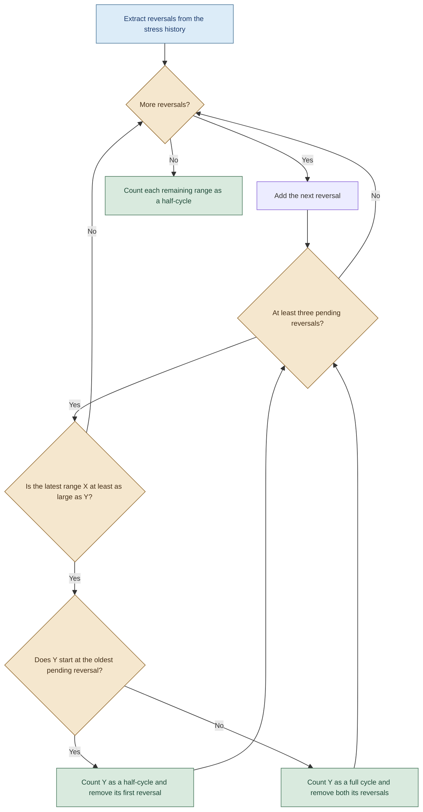
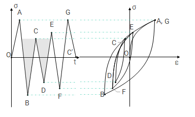
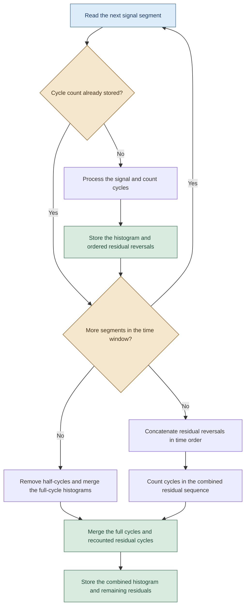
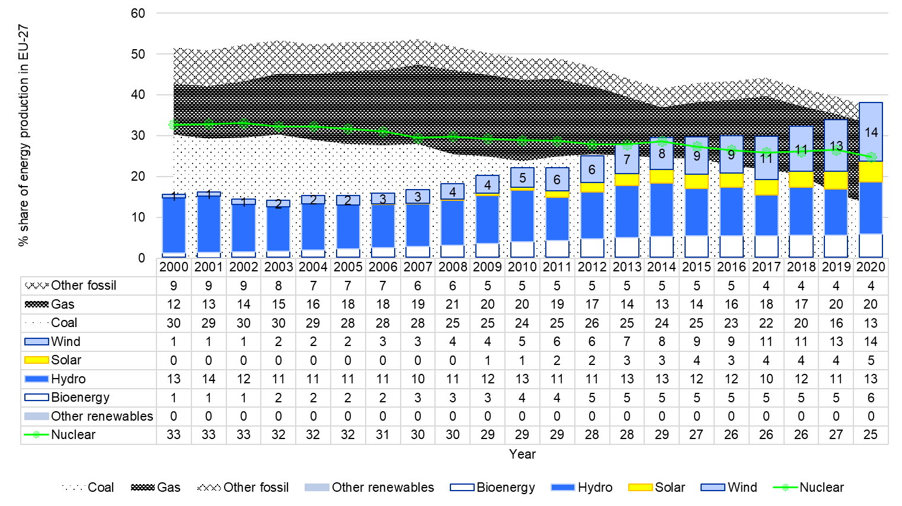
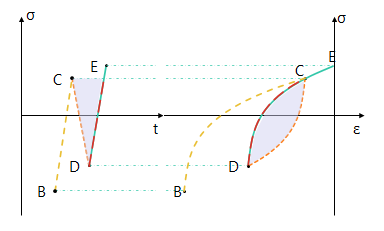
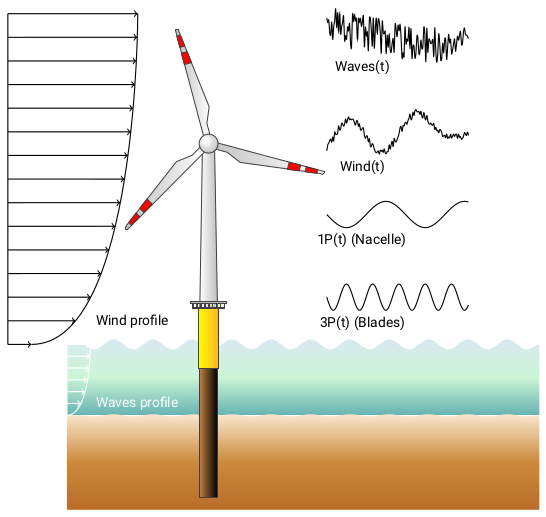

# 2. Rainflow and residuals

Rainflow counting converts an ordered stress record into a spectrum that
can be used in a fatigue analysis. The residual turning points keep track
of excursions that may continue in the next window.

## Rainflow

Rainflow counting extracts stress ranges, means and cycle counts from a
stress history. The v3 ASTM three-point implementation runs in Rust.
`CycleCount.from_timeseries` also accepts `rainflow_method="fourpoint"`.
Residual half-cycles carry unresolved excursions at the ends of the record.
Keep those residuals when combining windows. For measured input,
`CycleCount.from_sep005` converts supported stress units to MPa. For a
pyExSi signal, supply the sampling frequency and stress unit explicitly.
See [cycle counting and signal input](../examples/03-count-stress-cycles.md).

Initially, rainflow turns the load history into a sequence of time (t) ordered reversals. Reversals are the local minima and maxima where the load first derivative changes sign. The function counts cycles by considering a moving reference point of the sequence, Z, and a moving ordered three-point subset - t(subset) ≥ t(Z) - with these characteristics:

- The first and second points are collectively called Y.

- The second and third points are collectively called X.

- | In both X and Y, the points are sorted from earlier to later in
  | time, but are not necessarily consecutive in the reversal sequence.

The range of X, denoted by r(X), is the absolute value of the difference between the amplitude of the first point and the amplitude of the second point. The definition of r(Y) is analogous. The rainflow algorithm is as follows (the rainflow chart).

At the end, the function collects the different cycles and half-cycles and tabulates their ranges, their means, and the points at which they start and end. This information can then be used to produce a histogram of cycles.

**Example**

The following example shows how to use the rainflow algorithm to cycle-count the signal given in the image here below.

{ .glossary-figure }

<table>
<thead>
<tr>
<th>Z</th>
<th>Reversals</th>
<th>Out of data?</th>
<th>&lt; 3 reversals?</th>
<th>Y</th>
<th>X</th>
<th>r(X) &lt; r(Y)?</th>
<th>Y includes Z?</th>
<th>Actions</th>
</tr>
</thead>
<tbody>
<tr>
<td>O</td>
<td>O, A, B</td>
<td>No</td>
<td>No</td>
<td>OA</td>
<td>AB</td>
<td>No</td>
<td>Yes</td>
<td>

Show
<ol type="1">
<li>Count OA as ½.</li>
<li>Discard O.</li>
<li>Set Z to A.</li>
</ol>
</td>
</tr>
<tr>
<td>A</td>
<td>A, B</td>
<td>No</td>
<td>Yes</td>
<td>—</td>
<td>—</td>
<td>—</td>
<td>—</td>
<td>

Show
Read C.
</td>
</tr>
<tr>
<td>A</td>
<td>A, B, C</td>
<td>No</td>
<td>No</td>
<td>AB</td>
<td>BC</td>
<td>Yes</td>
<td>—</td>
<td>

Show
Read D
</td>
</tr>
<tr>
<td>A</td>
<td>A, B, C, D</td>
<td>No</td>
<td>No</td>
<td>BC</td>
<td>CD</td>
<td>Yes</td>
<td>—</td>
<td>

Show
Read E.
</td>
</tr>
<tr>
<td>A</td>
<td>A, B, C, D, E</td>
<td>No</td>
<td>No</td>
<td>CD</td>
<td>DE</td>
<td>No</td>
<td>No</td>
<td>

Show
<ol type="1">
<li>Count CD as 1.</li>
<li>Discard C and D.</li>
</ol>
</td>
</tr>
<tr>
<td>A</td>
<td>A, B, E,</td>
<td>No</td>
<td>No</td>
<td>AB</td>
<td>BE</td>
<td>Yes</td>
<td>—</td>
<td>

Show
Read F.
</td>
</tr>
<tr>
<td>A</td>
<td>A, B, E, F</td>
<td>No</td>
<td>No</td>
<td>BE</td>
<td>EF</td>
<td>Yes</td>
<td>—</td>
<td>

Show
Read G.
</td>
</tr>
<tr>
<td>A</td>
<td>A, B, E, F, G</td>
<td>No</td>
<td>No</td>
<td>EF</td>
<td>FG</td>
<td>No</td>
<td>No</td>
<td>

Show
<ol type="1">
<li>Count EF as 1.</li>
<li>Discard E and F.</li>
</ol>
</td>
</tr>
<tr>
<td>A</td>
<td>A, B, G</td>
<td>No</td>
<td>No</td>
<td>AB</td>
<td>BG</td>
<td>No</td>
<td>Yes</td>
<td>

Show
<ol type="1">
<li>Count AB as ½.</li>
<li>Discard A.</li>
<li>Set Z to B.</li>
</ol>
</td>
</tr>
<tr>
<td>B</td>
<td>B, G</td>
<td>Yes</td>
<td>—</td>
<td>—</td>
<td>—</td>
<td>—</td>
<td>—</td>
<td>

Show
Count BG as ½.
</td>
</tr>
</tbody>
</table>

## LFFD

In continuously monitored structures, keeping a count per recording
window makes long histories easier to store and process. An excursion
that crosses a window boundary may appear as multiple half-cycles when
the windows are counted independently. The remaining turning points
preserve the order needed to recover such excursions.

The method described by Marsh and coauthors uses the saved spectra and
ordered residuals. For example, count each window of a bending-moment
record and store its full-cycle histogram together with the residual
turning points. If the table also includes half-cycles, set those rows
aside during recovery. Concatenate the residual sequences in acquisition
order, count them again, then merge the recounted rows with the saved
full cycles. Keep any residuals left from this second pass for future
aggregation.

This lets you combine long runs or choose different analysis windows
using small retained histories. It still depends on continuous data.
If acquisition stopped between windows, the residuals cannot recover
the loading that went unmeasured.

For a worked example, see the [MCP LFFD walkthrough](../../mcp/06-recover-lffd.md)
or the [cycle-count aggregation notebook](../../11-cycle_count_aggregation.html).

## Fatigue loading in wind turbines

NASA's experimental multi-megawatt wind turbines of the 1970s and
1980s included steel tube towers. Experience with early designs helped
establish fatigue as a design requirement because the loads on a
turbine vary over its lifetime.

For offshore support structures, repeated loads and the corrosive
environment also affect inspection and maintenance. Structural health
monitoring captures histories that can inform fatigue-life estimates
and the timing of inspections. The figure below shows changes in the
energy mix during the expansion of wind power in the EU-27.

<figure class="align-center">

<figcaption>Figure 1. Percentage share of energy production in EU-27 countries from 2000 to 2020. Years 2019 and 2020 have been extrapolated by EMBER. Data from 2021. 2000 to 2018 are available from EUROSTAT.</figcaption>
</figure>

Stress–strain hysteresis loops show how a material responds to nested
loading excursions. Cycle counting uses the ordered peaks and valleys
to represent those excursions by their ranges and weights. By
convention, tensile stress is positive and compressive stress is
negative.

{ .glossary-figure }

{ .glossary-figure }

Changes in wind and rotor thrust can create slow excursions. Waves can
add faster cycles. The two effects can occur within the same record.

{ .glossary-figure }
