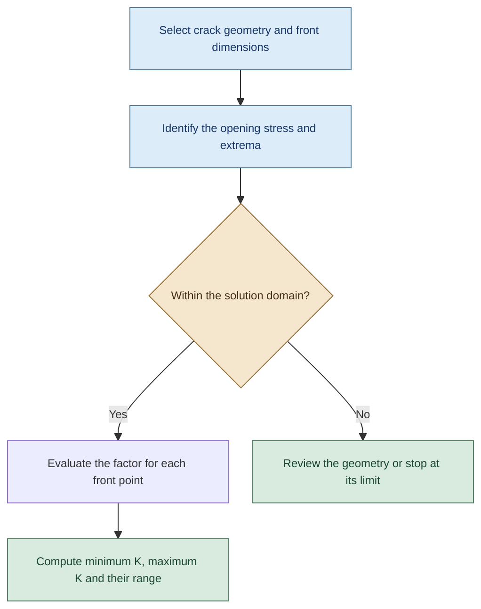
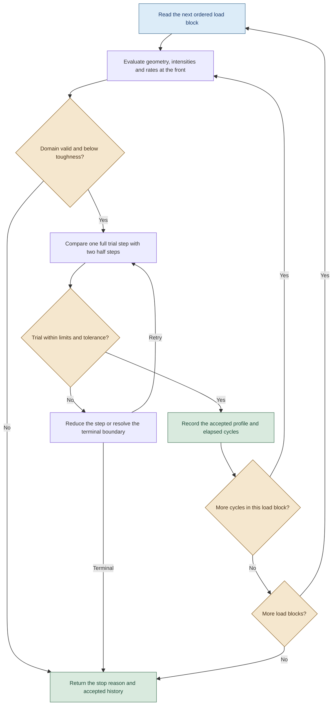

# 3. How ordered crack growth works

Sequential loading determines the crack dimensions at the start of the
next block. The geometry converts each applied load to stress intensity,
and the material law uses that intensity to advance the crack.

## NASGRO growth law

[`NasgroCurve`][py_fatigue.crack_growth.NasgroCurve] evaluates growth at a
crack-front point from the crack length and the two mode-I stress intensity
extrema. The user supplies the material coefficient and exponent, crack-opening
parameters, threshold parameters, and toughness. The threshold in the rate
law can depend on load ratio and finite crack size. See the
[material inputs](../../api/damage/ordered_crack_growth.md#material-inputs).

### NASGRO equation

For a tensile cycle with $0 \le K_\min < K_\max < K_c$, define the load
ratio $R=K_\min/K_\max$ and the opening fraction $f=K_\mathrm{op}/K_\max$.
The effective intensity range is

$$
\Delta K_\mathrm{eff}
= \frac{1-f}{1-R}\Delta K = (1-f)K_\max.
$$

The NASGRO growth law gives the crack advance per cycle.

$$
\frac{da}{dN}
= C\left(\Delta K_\mathrm{eff}\right)^n
  \frac{\left(1-\Delta K_\mathrm{th}/\Delta K\right)^p}
       {\left(1-K_\max/K_c\right)^q}.
$$

$C$ and $n$ parameterize the power-law part of the fit. $p$ controls
the approach to threshold and $q$ the acceleration near the fixed
toughness $K_c$. The threshold factor is one when $p=0$. When $p>0$ and
$\Delta K\le\Delta K_\mathrm{th}$, the growth rate is zero.
The near-toughness factor is one when $q=0$.

### Threshold, crack opening, and toughness

For the supported nonnegative stress ratios, the Newman opening function is

$$
f = \max\!\left(R, A_0 + A_1 R + A_2 R^2 + A_3 R^3\right).
$$

The coefficients depend on the constraint factor and the fitted ratio
of peak applied stress to flow stress. With $A_0=f(0)$ and $C_\mathrm{th}$
the threshold fanning constant, the threshold used by `NasgroCurve` is

$$
\Delta K_\mathrm{th}(a,R)
= \Delta K_0 \sqrt{\frac{a}{a+a_0}}
  \left[\frac{(1-A_0)(1-R)}{1-f}\right]^{1+C_\mathrm{th}R}.
$$

$\Delta K_0$ is the long-crack threshold at $R=0$ and $a_0=0.0381\,\mathrm{mm}$
is the intrinsic length in the NASGRO 3.0 expression. Taking the long-crack
limit makes the square-root factor one. See [Mettu et al., §2.1.1](https://ntrs.nasa.gov/citations/19990028759).

### From geometry and load to stress intensity

Under proportional tension, evaluate the chosen geometry at the current
crack dimensions, then multiply its factor by the applied stress at each
end of the load cycle. For a central through crack of half-length $a$ in
a plate of half-width $b$, the finite-width correction is

$$
Y(a) = \sqrt{\sec\!\left(\frac{\pi a}{2b}\right)},\qquad
K_\min=Y(a)\sigma_\min\sqrt{\pi a},\qquad
K_\max=Y(a)\sigma_\max\sqrt{\pi a}.
$$

A surface crack can use two factors and return two intensity pairs.
Keep the front-point order defined by its geometry. Use the reference
stress specified by the case. A geometry factor $Y$ is dimensionless.
A factor carrying $\sqrt{\mathrm{mm}}$ can instead multiply stress
directly to give MPa $\sqrt{\mathrm{mm}}$.

The following workflow is adapted from **Flow Diagram 4, Stress Intensity
Factor Determination**, in Appendix A of the NASGRO 3.0 manual. It shows the
operations exposed by the Py-Fatigue geometry classes.

### Advancing two front dimensions

For a semi-elliptical plate crack, the deepest point gives the rate of
depth $a$ and the surface point gives the rate of half-length $c$. An
integration trial advances the vector of sizes $\mathbf{x}=(a,c)$ over
a cycle increment $h$. If $\mathbf{g}$ denotes the vector of rates at the
current load, the trial compares

$$
\mathbf{x}_\mathrm{full}=\mathbf{x}+h\mathbf{g}(\mathbf{x}),
\qquad
\mathbf{x}_\mathrm{mid}=\mathbf{x}+\frac{h}{2}\mathbf{g}(\mathbf{x}),
\qquad
\mathbf{x}_\mathrm{half}=\mathbf{x}_\mathrm{mid}
   +\frac{h}{2}\mathbf{g}(\mathbf{x}_\mathrm{mid}).
$$

The solver accepts the two-half-step estimate when the difference in
each dimension fits the length tolerance. It reduces the cycle step
when the trial exceeds the tolerance or meets a terminal boundary.

This flowchart draws on **Flow Diagram 6, 2-D Crack Growth Computing
Scheme**, in Appendix A. The steps and termination paths describe
Py-Fatigue’s ordered solver.

See the [geometry and material sources](relevant_guidelines.md#crack-growth-and-stress-intensity-references)
and [ordered-growth example](../examples/07-ordered-crack-growth.md).

## Crack geometry and front

A **through crack** spans the thickness. A **surface crack** opens onto a
free surface and has a front inside the material. Several solutions advance
two front points independently. The geometry defines depth, half-length,
and the order of the reported intensities. See the
[geometry families and validity limits](../../api/damage/ordered_crack_growth.md#what-each-new-name-does).

For a semi-elliptical plate crack, a point with angle $\phi$ along the
front has position $x=c\cos\phi$ across the surface and depth
$z=a\sin\phi$. It reaches the deepest point at $\phi=\pi/2$.

**Net-section stress** describes stress in the remaining ligament. For a
central through crack with half-length $a$ in a plate of half-width $b$,
the same tension force acts through the remaining width $2(b-a)$:

$$
\sigma_\mathrm{net}=\frac{\sigma_\mathrm{gross}}{1-a/b}.
$$

The supported plate cases report this diagnostic separately. Use the
gross-section stress as the input to their mode-I intensity solutions.

## Ordered load block and termination

A [`LoadBlock`][py_fatigue.crack_growth.LoadBlock] contains the minimum and
maximum tensile stress in MPa and a possibly fractional cycle count.
[`simulate_crack_growth`][py_fatigue.crack_growth.simulate_crack_growth] applies
the blocks in the supplied order. A binned rainflow histogram cannot recover
that sequence.

A [`GrowthResult`][py_fatigue.crack_growth.GrowthResult] records accepted
cycle counts, crack dimensions, and per-tip intensity extrema. Spectrum
exhaustion means the solver completed the supplied history. A toughness or
geometry stop identifies the reached boundary. The final accepted profile
is on the admissible side of the terminal cycle bracket.
