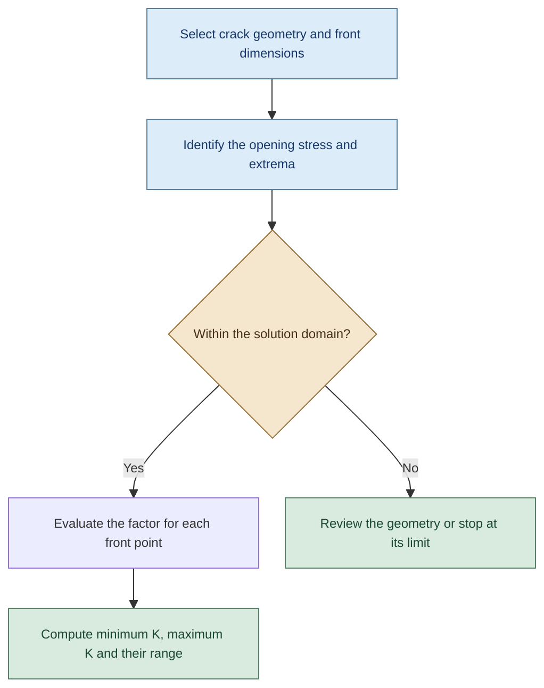
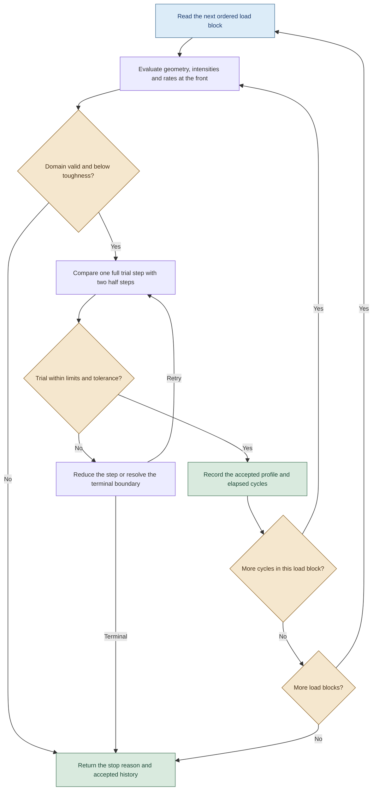
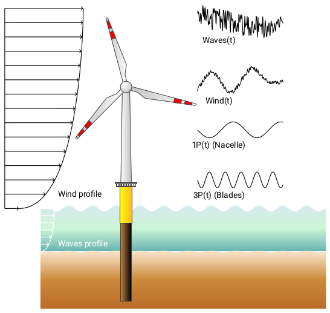
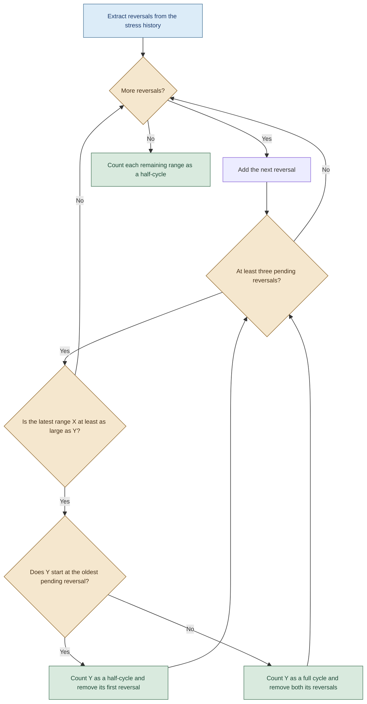
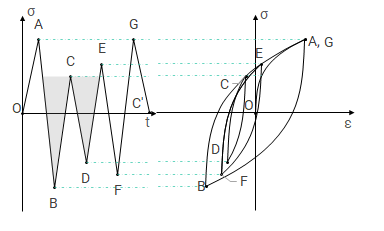
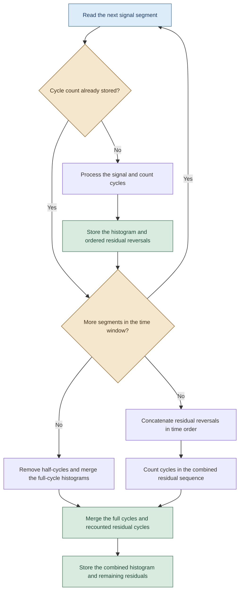

# Glossary

------------------------------------------------------------------------

## Fatigue

Fatigue is the deterioration of a material over time.

The first modern multi-megawatt wind turbines were developed and installed in the 1970s in the United States, under the impulse of the National Aviation and Space Administration (NASA). From 1974 through the mid-1980s, thirteen experimental wind turbines of four different designs started their operations. This research and development program pioneered many of the multi-megawatt turbine technologies in use today, including steel tube towers, being the protagonists of this work. Initially, designers developed them using static and quasi-static analysis. In the best scenarios, such simple designs led to over-designed tur-bines, while in the worst, they led to premature failures. Engineers soon realized that wind turbines are fatigue-critical machines experiencing unique load spectra in their lifetime. Concerning offshore wind sup-port structures, corrosion is another critical failure mode besides fatigue. The low accessibility and high inspection/repair costs of large assemblies in corrosive environments motivate remote monitoring and optimized inspection and maintenance plans based on continuous assessment of the structure's reliability. Remote monitoring has given access to a vast quantity of data that today are being used to update the fa-tigue life of existing structures.

Due to the time-variant uncertainties associated with fatigue loads, corrosion, stress prediction, and model-ling of the deterioration mechanisms, a more advanced lifecycle reliability assessment is necessary to assess structural safety and support decision making. This could eventually reduce operation and maintenance costs, and help further boosting of an energy source that is inevitably becoming a main player in the mar-ket, growing from 1 to 14% of share (onshore + offshore) from 2000 to 2020 in EU-27 countries, as we show here below.

<figure class="align-center">

<figcaption>Figure 1. Percentage share of energy production in EU-27 countries from 2000 to 2020. Years 2019 and 2020 have been extrapolated by EMBER. Data from 2021. 2000 to 2018 are available from EUROSTAT.</figcaption>
</figure>

Fatigue analysis studies how damage accumulates in an object subjected to cyclic stress variations.

Hysteresis and memory dependence, or fatigue, are basic characteristics of many complex systems. A prerequisite for hysteresis is that the systems have sufficiently many metastable states so that, if they are subjected to cyclic loading, there are at least two distinct sequences of states that connect the initial and final configurations to some intermediate point of the cycle. Memory dependence is qualitatively more complicated. In hysteresis systems the existence of a memory is essentially equivalent to the existence of a counting mechanism that is capable of recording the cumulation of successive cycles. These can be estimated by cycle-counting the time series through algorithms such as [rainflow](glossary.md#rainflow) (cfr. Figure 2) or rainfill (also known as four-point ASTM). Cycles are usually represented as sinusoids, and their extremes are defined as peaks (maximum stress, σ~max~) and valleys (minimum stress, σ~min~), as shown in Figure 3. Tensile stresses are taken to be positive and compressive stresses are taken to be negative.

{ .glossary-figure }

{ .glossary-figure }

## Stress ranges

The stress range is identified as Δσ and it is the difference between the maximum and the minimum stress in the fatigue cycle

$$\Delta\sigma = \sigma_{max} - \sigma_{min}$$

## Stress Amplitudes

Half of the stress range

$$\sigma_{alt} = \frac{\sigma_{max} - \sigma_{min}}{2}$$

## Mean stress

The mean stress is the average of the maximum and minimum stresses in the fatigue cycle.

$$\sigma_{mean} = \frac{(\sigma_{max} + \sigma_{min})}{2}$$

## Load ratio

The load ratio is the minimum stress divided by the maximum stress. At a
fixed crack size under proportional mode-I loading, the corresponding ratio
is $K_\min/K_\max$.

$$R = \frac{\sigma_{\min}}{\sigma_{\max}}$$

## SIF range

The mode-I stress intensity factor $K$ describes the near-tip opening
stress field. It has units of stress times the square root of length, such
as MPa √mm. Its range is $\Delta K = K_\max - K_\min$.

$$\Delta K = Y(a)\,\Delta\sigma\sqrt{\pi a}$$

Here $Y(a)$ is the dimensionless geometry factor, $a$ is the crack dimension
defined by the selected solution, and $\Delta\sigma$ is the applied stress
range. A surface-crack solution can give a different $K$ at each front point.

## Crack growth rate

The crack growth rate $da/dN$ is the advance of a crack dimension per cycle,
for example in mm/cycle. Py-Fatigue v3 provides Paris, Walker and NASGRO
growth laws. Use material coefficients calibrated in units consistent with
the analysis.

## Paris' law

$$\frac{da}{dN} = C(\Delta K)^m$$

The exponent $m$ is the slope in log–log coordinates. $C$ is the coefficient
in the chosen unit system. A Walker model adjusts the growth rate for the
load ratio. See the [crack-growth curve guide](../examples/03-cg_curve.md).

## NASGRO growth law

[`NasgroCurve`][py_fatigue.crack_growth.NasgroCurve] evaluates growth at a
crack-front point from the crack length and the two mode-I stress intensity
extrema. The user supplies the material coefficient and exponent, crack-opening
parameters, threshold parameters, and toughness. The threshold in the rate
law can depend on load ratio and finite crack size. See the
[material inputs](../examples/08-ordered-crack-growth.md#material-inputs).

### NASGRO equation

For a tensile cycle with $0 \le K_\min < K_\max < K_c$, define the load
ratio $R=K_\min/K_\max$ and the opening fraction $f=K_\mathrm{op}/K_\max$.
The effective intensity range is

$$
\Delta K_\mathrm{eff}
= \frac{1-f}{1-R}\Delta K = (1-f)K_\max.
$$

The NASGRO growth law gives the crack advance per cycle.

$$
\frac{da}{dN}
= C\left(\Delta K_\mathrm{eff}\right)^n
  \frac{\left(1-\Delta K_\mathrm{th}/\Delta K\right)^p}
       {\left(1-K_\max/K_c\right)^q}.
$$

$C$ and $n$ parameterize the power-law part of the fit. $p$ controls
the approach to threshold and $q$ the acceleration near the fixed
toughness $K_c$. The threshold factor is one when $p=0$. When $p>0$ and
$\Delta K\le\Delta K_\mathrm{th}$, the growth rate is zero.
The near-toughness factor is one when $q=0$.

### Threshold, crack opening, and toughness

For the supported nonnegative stress ratios, the Newman opening function is

$$
f = \max\!\left(R, A_0 + A_1 R + A_2 R^2 + A_3 R^3\right).
$$

The coefficients depend on the constraint factor and the fitted ratio
of peak applied stress to flow stress. With $A_0=f(0)$ and $C_\mathrm{th}$
the threshold fanning constant, the threshold used by `NasgroCurve` is

$$
\Delta K_\mathrm{th}(a,R)
= \Delta K_0 \sqrt{\frac{a}{a+a_0}}
  \left[\frac{(1-A_0)(1-R)}{1-f}\right]^{1+C_\mathrm{th}R}.
$$

$\Delta K_0$ is the long-crack threshold at $R=0$ and $a_0=0.0381\,\mathrm{mm}$
is the intrinsic length in the NASGRO 3.0 expression. Taking the long-crack
limit makes the square-root factor one. See [Mettu et al., §2.1.1](https://ntrs.nasa.gov/citations/19990028759).

### From geometry and load to stress intensity

Under proportional tension, evaluate the chosen geometry at the current
crack dimensions, then multiply its factor by the applied stress at each
end of the load cycle. For a central through crack of half-length $a$ in
a plate of half-width $b$, the finite-width correction is

$$
Y(a) = \sqrt{\sec\!\left(\frac{\pi a}{2b}\right)},\qquad
K_\min=Y(a)\sigma_\min\sqrt{\pi a},\qquad
K_\max=Y(a)\sigma_\max\sqrt{\pi a}.
$$

A surface crack can use two factors and return two intensity pairs.
Keep the front-point order defined by its geometry. Use the reference
stress specified by the case. A geometry factor $Y$ is dimensionless.
A factor carrying $\sqrt{\mathrm{mm}}$ can instead multiply stress
directly to give MPa $\sqrt{\mathrm{mm}}$.

The following workflow is adapted from **Flow Diagram 4, Stress Intensity
Factor Determination**, in Appendix A of the NASGRO 3.0 manual. It shows the
operations exposed by the Py-Fatigue geometry classes.

### Advancing two front dimensions

For a semi-elliptical plate crack, the deepest point gives the rate of
depth $a$ and the surface point gives the rate of half-length $c$. An
integration trial advances the vector of sizes $\mathbf{x}=(a,c)$ over
a cycle increment $h$. If $\mathbf{g}$ denotes the vector of rates at the
current load, the trial compares

$$
\mathbf{x}_\mathrm{full}=\mathbf{x}+h\mathbf{g}(\mathbf{x}),
\qquad
\mathbf{x}_\mathrm{mid}=\mathbf{x}+\frac{h}{2}\mathbf{g}(\mathbf{x}),
\qquad
\mathbf{x}_\mathrm{half}=\mathbf{x}_\mathrm{mid}
   +\frac{h}{2}\mathbf{g}(\mathbf{x}_\mathrm{mid}).
$$

The solver accepts the two-half-step estimate when the difference in
each dimension fits the length tolerance. It reduces the cycle step
when the trial exceeds the tolerance or meets a terminal boundary.

This flowchart draws on **Flow Diagram 6, 2-D Crack Growth Computing
Scheme**, in Appendix A. The steps and termination paths describe
Py-Fatigue’s ordered solver.

See the [geometry and material sources](relevant_guidelines.md#crack-growth-and-stress-intensity-references)
and [ordered-growth example](../examples/08-ordered-crack-growth.md).

## Crack geometry and front

A **through crack** spans the thickness. A **surface crack** opens onto a
free surface and has a front inside the material. Several solutions advance
two front points independently. The geometry defines depth, half-length,
and the order of the reported intensities. See the
[geometry families and validity limits](../examples/08-ordered-crack-growth.md).

For a semi-elliptical plate crack, a point with angle $\phi$ along the
front has position $x=c\cos\phi$ across the surface and depth
$z=a\sin\phi$. It reaches the deepest point at $\phi=\pi/2$.

**Net-section stress** describes stress in the remaining ligament. For a
central through crack with half-length $a$ in a plate of half-width $b$,
the same tension force acts through the remaining width $2(b-a)$:

$$
\sigma_\mathrm{net}=\frac{\sigma_\mathrm{gross}}{1-a/b}.
$$

The supported plate cases report this diagnostic separately. Use the
gross-section stress as the input to their mode-I intensity solutions.

## Ordered load block and termination

A [`LoadBlock`][py_fatigue.crack_growth.LoadBlock] contains the minimum and
maximum tensile stress in MPa and a possibly fractional cycle count.
[`simulate_crack_growth`][py_fatigue.crack_growth.simulate_crack_growth] applies
the blocks in the supplied order. A binned rainflow histogram cannot recover
that sequence.

A [`GrowthResult`][py_fatigue.crack_growth.GrowthResult] records accepted
cycle counts, crack dimensions, and per-tip intensity extrema. Spectrum
exhaustion means the solver completed the supplied history. A toughness or
geometry stop identifies the reached boundary. The final accepted profile
is on the admissible side of the terminal cycle bracket.

## Tabulated geometry factor

[`TabulatedGeometryFactor`][py_fatigue.geometry.generic.TabulatedGeometryFactor]
interpolates a dimensionless $Y$ against one growing crack dimension in
[`get_crack_growth`][py_fatigue.damage.crack_growth.get_crack_growth]. The
last tabulated depth is a geometry limit. See the
[MERC-3 comparison](../../tutorials/40-afgrow_merc3_longeron.html).

## Cycle-counting

Refer to [rainflow](glossary.md#rainflow) for more information.

Fatigue Loads in Offshore Wind turbines \-\-\-\-\-\-\-\-\-\-\-\-\-\-\-\-\-\-\-\-\-\-\-\-- Concerning offshore wind turbines, fatigue cycles come from multiple sources and affect the structure both at high and low frequencies. Usually loads deriving from thrust and wind generate low-frequency (slowly-varying) fatigue cycles, while waves form high-frequency (fast-varying) fatigue cycles, as schematical-ly illustrated in Figure 4.

{ .glossary-figure }

## Rainflow

Rainflow counting extracts stress ranges, means and cycle counts from a
stress history. The v3 ASTM three-point implementation runs in Rust.
`CycleCount.from_timeseries` also accepts `rainflow_method="fourpoint"`.
Residual half-cycles carry unresolved excursions at the ends of the record.
Keep those residuals when combining windows. For measured input,
`CycleCount.from_sep005` converts supported stress units to MPa. For a
pyExSi signal, supply the sampling frequency and stress unit explicitly.
See [cycle counting and signal input](../examples/04-cycle_counting.md).

Initially, rainflow turns the load history into a sequence of time (t) ordered reversals. Reversals are the local minima and maxima where the load first derivative changes sign. The function counts cycles by considering a moving reference point of the sequence, Z, and a moving ordered three-point subset - t(subset) ≥ t(Z) - with these characteristics:

- The first and second points are collectively called Y.

- The second and third points are collectively called X.

- | In both X and Y, the points are sorted from earlier to later in
  | time, but are not necessarily consecutive in the reversal sequence.

The range of X, denoted by r(X), is the absolute value of the difference between the amplitude of the first point and the amplitude of the second point. The definition of r(Y) is analogous. The rainflow algorithm is as follows (the rainflow chart).

At the end, the function collects the different cycles and half-cycles and tabulates their ranges, their means, and the points at which they start and end. This information can then be used to produce a histogram of cycles.

**Example**

The following example shows how to use the rainflow algorithm to cycle-count the signal given in the image here below.

{ .glossary-figure }

<table>
<thead>
<tr>
<th>Z</th>
<th>Reversals</th>
<th>Out of data?</th>
<th>&lt; 3 reversals?</th>
<th>Y</th>
<th>X</th>
<th>r(X) &lt; r(Y)?</th>
<th>Y includes Z?</th>
<th>Actions</th>
</tr>
</thead>
<tbody>
<tr>
<td>O</td>
<td>O, A, B</td>
<td>No</td>
<td>No</td>
<td>OA</td>
<td>AB</td>
<td>No</td>
<td>Yes</td>
<td>

Show
<ol type="1">
<li>Count OA as ½.</li>
<li>Discard O.</li>
<li>Set Z to A.</li>
</ol>
</td>
</tr>
<tr>
<td>A</td>
<td>A, B</td>
<td>No</td>
<td>Yes</td>
<td>—</td>
<td>—</td>
<td>—</td>
<td>—</td>
<td>

Show
Read C.
</td>
</tr>
<tr>
<td>A</td>
<td>A, B, C</td>
<td>No</td>
<td>No</td>
<td>AB</td>
<td>BC</td>
<td>Yes</td>
<td>—</td>
<td>

Show
Read D
</td>
</tr>
<tr>
<td>A</td>
<td>A, B, C, D</td>
<td>No</td>
<td>No</td>
<td>BC</td>
<td>CD</td>
<td>Yes</td>
<td>—</td>
<td>

Show
Read E.
</td>
</tr>
<tr>
<td>A</td>
<td>A, B, C, D, E</td>
<td>No</td>
<td>No</td>
<td>CD</td>
<td>DE</td>
<td>No</td>
<td>No</td>
<td>

Show
<ol type="1">
<li>Count CD as 1.</li>
<li>Discard C and D.</li>
</ol>
</td>
</tr>
<tr>
<td>A</td>
<td>A, B, E,</td>
<td>No</td>
<td>No</td>
<td>AB</td>
<td>BE</td>
<td>Yes</td>
<td>—</td>
<td>

Show
Read F.
</td>
</tr>
<tr>
<td>A</td>
<td>A, B, E, F</td>
<td>No</td>
<td>No</td>
<td>BE</td>
<td>EF</td>
<td>Yes</td>
<td>—</td>
<td>

Show
Read G.
</td>
</tr>
<tr>
<td>A</td>
<td>A, B, E, F, G</td>
<td>No</td>
<td>No</td>
<td>EF</td>
<td>FG</td>
<td>No</td>
<td>No</td>
<td>

Show
<ol type="1">
<li>Count EF as 1.</li>
<li>Discard E and F.</li>
</ol>
</td>
</tr>
<tr>
<td>A</td>
<td>A, B, G</td>
<td>No</td>
<td>No</td>
<td>AB</td>
<td>BG</td>
<td>No</td>
<td>Yes</td>
<td>

Show
<ol type="1">
<li>Count AB as ½.</li>
<li>Discard A.</li>
<li>Set Z to B.</li>
</ol>
</td>
</tr>
<tr>
<td>B</td>
<td>B, G</td>
<td>Yes</td>
<td>—</td>
<td>—</td>
<td>—</td>
<td>—</td>
<td>—</td>
<td>

Show
Count BG as ½.
</td>
</tr>
</tbody>
</table>

## Damage Equivalent Stress Range

The damage equivalent stress range (DES) represents linear fatigue damage
as a constant stress range. Applying $N_{eq}$ cycles at the DES produces
the same damage as the original signal.

We use the definition by [ECN](https://publicaties.ecn.nl/PdfFetch.aspx?nr=ECN-C--95-074).

$$DES = \left(\frac{\sum_in_i\cdot{}\Delta{}\sigma{}_i^m}{N_{eq}}\right)^{1/m}$$

## SN Curve

An S–N or Wöhler curve gives the fatigue life in cycles at a given
stress range. On one branch of an `SNCurve`, its base-10 intercept $b$
and slope $m$ give

$$
\log_{10} N = b - m\log_{10}\Delta\sigma,
\qquad N = 10^b (\Delta\sigma)^{-m}.
$$

For a multi-branch curve, use the slope and intercept of the branch
containing the stress range. See the [S–N curve guide](../examples/02-sn_curve.md).

## Damage Equivalent Moment

The damage equivalent moment applies the same principle as the
[damage equivalent stress range](#damage-equivalent-stress-range) to bending
moment.

## Palmgren-Miner Rule

Rule for linear fatigue, uses the idea of [SN curve](glossary.md) to determine the fatigue damage of a material or detail under the loading.

$$D = \sum_i(\frac{n_i}{N_i(\Delta{}\sigma_i)})$$

with $n_i$ the number of cycles of a given stress range $\sigma_i$. $N_i$ is the number of permisable cycles according to the [SN Curve](glossary.md).

## Residuals

Residual cycles or half-cycles are cycles that are not closed in the processed timeseries. They are sometimesreferred to as half-cycles and counted as 0.5 cycles in a cycle counting.

An alternative way of dealing with residual cycles is to store them seperately and process them in a second run.

## Half-cycles

See [residuals](glossary.md).

## SHM

[Structural health monitoring](https://en.wikipedia.org/wiki/Structural_health_monitoring).

## Timestamp

A timestamp is a time information that is associated with a particular segmented data series. Usually it is represented as a [datetime.datetime](https://docs.python.org/3/library/datetime.html) instance.

## LFFD

Performing a lifetime assessment for years' worth of SHM data is a computational time-demanding operation. The data we use are acquired at a sampling frequencies that can be tens of Hertz or even more. This means that if we perform the lifetime assessment by reversals identification and cycle-counting the concatenated signal of the period of interest, it takes too much calculation effort and time and lacks flexibility. This bottleneck can be easily eliminated by cycle-counting and storing the histogram of every segmented subset of data.

Notwithstanding, cycle-counting generates a new issue: whenever cycle-counting a segmented subset, a series of so-called residual cycles will be left. Residual cycles are also called half-cycles because they are conventionally artificially added to the final histogram as 0.5 cycles times their corresponding stress ranges, meaning that we are de-facto adulterating the actual fatigue histogram by adding spurious information to it. Mathematically speaking, residuals are cycles that did not have the time to complete yet, because some physical events, happening at very low frequencies, cannot be captured within the data segment. Therefore, an ideally infinite time series would have zero residuals. The first and most obvious solution to this error is to concatenate the segmented time series in the time window of interest, then perform cycle-count and the fatigue analysis using the resulting histogram. This option is undoubtedly time/memory demanding as, besides the final cycle-counting, it requires a high amount of data processing for each subset. Secondly, this approach is certainly not flexible as the sequence of operations just described shall be repeated for each analysis performed. Last, we also have to deal with gaps in the data. Even if the ambition were to concatenate everything, we would still make errors as such.

Marsh *et al.* have introduced a brilliant approach that significantly reduces calculation time without losing accuracy in the final spectrum histogram, as it can retrieve all the hysteresis cycles caused by LFFD without needing the a-priori signal concatenation. We have modified the approach to give us the necessary flexibility to deal with different sized time windows at every runtime, and re-cycle-counting will not be needed. The approach follows:

1.  Import the segmented-long signal.
2.  Process the signal into fore-aft and side-side bending moments.
3.  Cycle-count the resulting bending moments which yields to a histogram of the full cycles and its residuals as half-cycles.
4.  Extend the resulting histogram, to include the sequence of time ordered reversals of the residuals as well
5.  Store the extended histogram as a file.

By storing the extended histograms, we save storage space and calculation time compared to concatenating strain-time signals. Moreover, we can also perform assessments based on the segmented subsets and the long-term data. The residuals are stored twice at this stage as half cycles in the \"extended\" histogram and as a sequence. In the second part of the algorithm, we recover the LFFD over an extended period (e.g. years). For each stored extended histogram:

6.  Remove the half cycles from the histogram to obtain a \"full cycles\" histogram and merge all histograms of the considered period.
7.  Concatenate the residuals sequence.
8.  Cycle-count the concatenated residuals sequence.
9.  Merge the merged full cycles histogram and the residuals histogram (residuals of the residuals).

