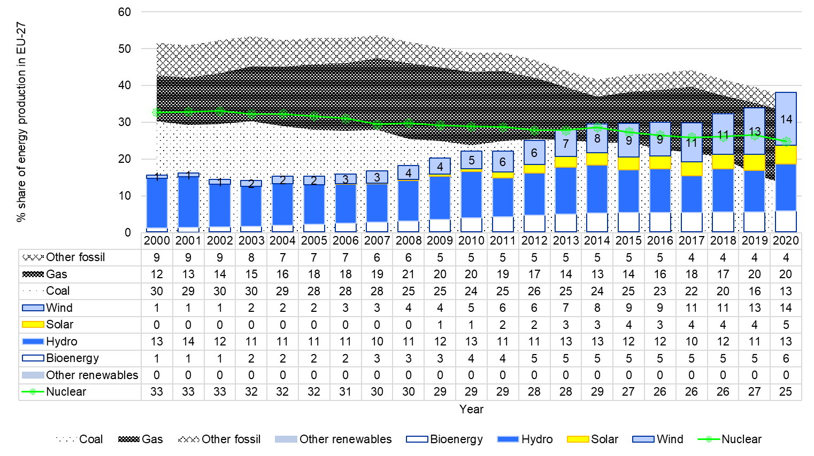
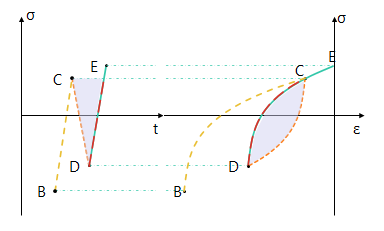
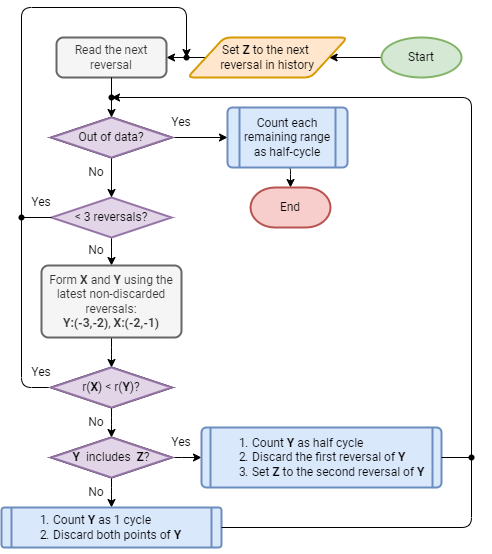
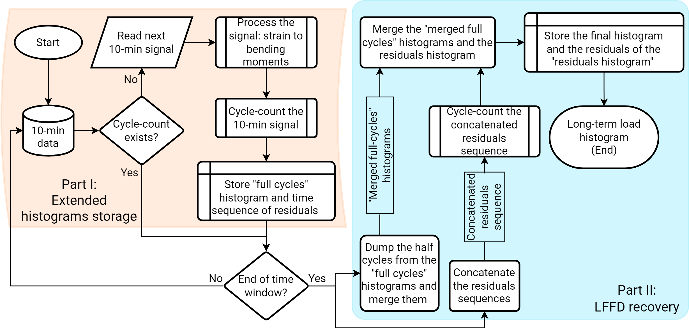

# Glossary

------------------------------------------------------------------------

## Fatigue

Fatigue is the deterioration of a material over time.

The first modern multi-megawatt wind turbines were developed and installed in the 1970s in the United States, under the impulse of the National Aviation and Space Administration (NASA). From 1974 through the mid-1980s, thirteen experimental wind turbines of four different designs started their operations. This research and development program pioneered many of the multi-megawatt turbine technologies in use today, including steel tube towers, being the protagonists of this work. Initially, designers developed them using static and quasi-static analysis. In the best scenarios, such simple designs led to over-designed tur-bines, while in the worst, they led to premature failures. Engineers soon realized that wind turbines are fatigue-critical machines experiencing unique load spectra in their lifetime. Concerning offshore wind sup-port structures, corrosion is another critical failure mode besides fatigue. The low accessibility and high inspection/repair costs of large assemblies in corrosive environments motivate remote monitoring and optimized inspection and maintenance plans based on continuous assessment of the structure's reliability. Remote monitoring has given access to a vast quantity of data that today are being used to update the fa-tigue life of existing structures.

Due to the time-variant uncertainties associated with fatigue loads, corrosion, stress prediction, and model-ling of the deterioration mechanisms, a more advanced lifecycle reliability assessment is necessary to assess structural safety and support decision making. This could eventually reduce operation and maintenance costs, and help further boosting of an energy source that is inevitably becoming a main player in the mar-ket, growing from 1 to 14% of share (onshore + offshore) from 2000 to 2020 in EU-27 countries, as we show here below.

<figure class="align-center">

<figcaption>Figure 1. Percentage share of energy production in EU-27 countries from 2000 to 2020. Years 2019 and 2020 have been extrapolated by EMBER. Data from 2021. 2000 to 2018 are available from EUROSTAT.</figcaption>
</figure>

Fatigue analysis studies how damage accumulates in an object subjected to cyclic stress variations.

Hysteresis and memory dependence, or fatigue, are basic characteristics of many complex systems. A prerequisite for hysteresis is that the systems have sufficiently many metastable states so that, if they are subjected to cyclic loading, there are at least two distinct sequences of states that connect the initial and final configurations to some intermediate point of the cycle. Memory dependence is qualitatively more complicated. In hysteresis systems the existence of a memory is essentially equivalent to the existence of a counting mechanism that is capable of recording the cumulation of successive cycles. These can be estimated by cycle-counting the time series through algorithms such as [rainflow](glossary.md#rainflow) (cfr. Figure 2) or rainfill (also known as four-point ASTM). Cycles are usually represented as sinusoids, and their extremes are defined as peaks (maximum stress, σ~max~) and valleys (minimum stress, σ~min~), as shown in Figure 3. Tensile stresses are taken to be positive and compressive stresses are taken to be negative.

{alt="Nested cycle within a residual"}

{alt="Nested cycle within a residual"}

## Stress ranges

The stress range is identified as Δσ and it is the difference between the maximum and the minimum stress in the fatigue cycle

$$\Delta\sigma = \sigma_{max} - \sigma_{min}$$

## Stress Amplitudes

Half of the stress range

$$\sigma_{alt} = \frac{\sigma_{max} - \sigma_{min}}{2}$$

## Mean stress

The mean stress is the average of the maximum and minimum stresses in the fatigue cycle.

$$\sigma_{mean} = \frac{(\sigma_{max} + \sigma_{min})}{2}$$

## Load ratio

The load ratio is the ratio of the mean stress to the maximum stress, equally known as ratio of peak to valley.

$$R = \frac{\sigma_{mean}}{\sigma_{max}}$$

## SIF range

The SIF range is the difference between the maximum and the minimum Stress Intencity Factor in the fatigue cycle, and it is indicated as $\Delta K$. The stress intensity factor is a measure of the stress concentration at a crack tip. It is a dimensionless quantity that is used to predict the crack growth rate in a material.

$$\Delta K = Y(a) \cdot \Delta \sigma \sqrt{\pi \, a}$$

where: - $a$ is the crack length - $Y(a)$ is the gemoetric factor - $\Delta \sigma$ is the stress range

## Crack growth rate

The crack growth rate is the rate at which a crack grows in a material under a given set of conditions. It is a measure of the rate of propagation of a crack in a material. It is usually expressed in millimeters per fatigue cycles (mm/cycle).

The crack growth rate is usually calculated using the Paris' law:

## Paris' law

A material property defining a power law relation between the crack growth rate and the stress intensity factor range:

$$\frac{da}{dN} = C \cdot \Delta K^m$$

where: - $C$ is the Paris coefficient (intercept) - $m$ is the Paris exponent (slope) - $\Delta K$ is the SIF range

## Cycle-counting

Refer to [rainflow](glossary.md#rainflow) for more information.

Fatigue Loads in Offshore Wind turbines \-\-\-\-\-\-\-\-\-\-\-\-\-\-\-\-\-\-\-\-\-\-\-\-- Concerning offshore wind turbines, fatigue cycles come from multiple sources and affect the structure both at high and low frequencies. Usually loads deriving from thrust and wind generate low-frequency (slowly-varying) fatigue cycles, while waves form high-frequency (fast-varying) fatigue cycles, as schematical-ly illustrated in Figure 4.

{alt="Schematics of the loads acting on an offshore wind turbine"}

## Rainflow

Rainflow counting estimates the number of load change cycles as a function of cycle amplitude.

Initially, rainflow turns the load history into a sequence of time (t) ordered reversals. Reversals are the local minima and maxima where the load first derivative changes sign. The function counts cycles by considering a moving reference point of the sequence, Z, and a moving ordered three-point subset - t(subset) ≥ t(Z) - with these characteristics:

- The first and second points are collectively called Y.

- The second and third points are collectively called X.

- | In both X and Y, the points are sorted from earlier to later in
  | time, but are not necessarily consecutive in the reversal sequence.

The range of X, denoted by r(X), is the absolute value of the difference between the amplitude of the first point and the amplitude of the second point. The definition of r(Y) is analogous. The rainflow algorithm is as follows (the rainflow chart).

At the end, the function collects the different cycles and half-cycles and tabulates their ranges, their means, and the points at which they start and end. This information can then be used to produce a histogram of cycles.

**Example**

The following example shows how to use the rainflow algorithm to cycle-count the signal given in the image here below.

<table style="width:96%;">
<colgroup>
<col style="width: 4%" />
<col style="width: 11%" />
<col style="width: 12%" />
<col style="width: 11%" />
<col style="width: 6%" />
<col style="width: 6%" />
<col style="width: 11%" />
<col style="width: 13%" />
<col style="width: 17%" />
</colgroup>
<thead>
<tr>
<th>Z</th>
<th>
Reversals

(Rev.s)
</th>
<th>Out of data?</th>
<th>&lt; 3 Rev.s?</th>
<th>Y</th>
<th>X</th>
<th>r(X) &lt; r(Y)?</th>
<th>Y includes Z?</th>
<th>Actions</th>
</tr>
</thead>
<tbody>
<tr>
<td>O</td>
<td>O, A, B</td>
<td>No</td>
<td>No</td>
<td>OA</td>
<td>AB</td>
<td>No</td>
<td>Yes</td>
<td><ol type="1">
<li>Count OA as ½.</li>
<li>Discard O.</li>
<li>Set Z to A.</li>
</ol></td>
</tr>
<tr>
<td>A</td>
<td>A, B</td>
<td>No</td>
<td>Yes</td>
<td>—</td>
<td>—</td>
<td>—</td>
<td>—</td>
<td>Read C.</td>
</tr>
<tr>
<td>A</td>
<td>A, B, C</td>
<td>No</td>
<td>No</td>
<td>AB</td>
<td>BC</td>
<td>Yes</td>
<td>—</td>
<td>Read D</td>
</tr>
<tr>
<td>A</td>
<td>A, B, C, D</td>
<td>No</td>
<td>No</td>
<td>BC</td>
<td>CD</td>
<td>Yes</td>
<td>—</td>
<td>Read E.</td>
</tr>
<tr>
<td>A</td>
<td>A, B, C, D, E</td>
<td>No</td>
<td>No</td>
<td>CD</td>
<td>DE</td>
<td>No</td>
<td>No</td>
<td><ol type="1">
<li>Count CD as 1.</li>
<li>Discard C and D.</li>
</ol></td>
</tr>
<tr>
<td>A</td>
<td>A, B, E,</td>
<td>No</td>
<td>No</td>
<td>AB</td>
<td>BE</td>
<td>Yes</td>
<td>—</td>
<td>Read F.</td>
</tr>
<tr>
<td>A</td>
<td>A, B, E, F</td>
<td>No</td>
<td>No</td>
<td>BE</td>
<td>EF</td>
<td>Yes</td>
<td>—</td>
<td>Read G.</td>
</tr>
<tr>
<td>A</td>
<td>A, B, E, F, G</td>
<td>No</td>
<td>No</td>
<td>EF</td>
<td>FG</td>
<td>No</td>
<td>No</td>
<td><ol type="1">
<li>Count EF as 1.</li>
<li>Discard E and F.</li>
</ol></td>
</tr>
<tr>
<td>A</td>
<td>A, B, G</td>
<td>No</td>
<td>No</td>
<td>AB</td>
<td>BG</td>
<td>No</td>
<td>Yes</td>
<td><ol type="1">
<li>Count AB as ½.</li>
<li>Discard A.</li>
<li>Set Z to B.</li>
</ol></td>
</tr>
<tr>
<td>B</td>
<td>B, G</td>
<td>Yes</td>
<td>—</td>
<td>—</td>
<td>—</td>
<td>—</td>
<td>—</td>
<td>Count BG as ½.</td>
</tr>
</tbody>
</table>

Damage Equivalent Stress Range \-\-\-\-\-\-\-\-\-\-\-\-\-\-\-\-\-\-\-\-\-\-\-\-- The damage equivalent stress range or (DES) is a simple way to linearize a damage value. It is a common approach to represent linear damage results. The basic idea is that $N_{eq}$ cycles with a stress range of DES induce as much damage as are present in the signal.

We use the defintion by [ECN](https://publicaties.ecn.nl/PdfFetch.aspx?nr=ECN-C--95-074)

$$DES = \left(\frac{\sum_in_i\cdot{}\Delta{}\sigma{}_i^m}{N_{eq}}\right)^{1/m}$$

## SN Curve

Or Wöhler-curve, a material property that expresses the number of cycles a material (or weld detail) can withstand prior to failing due to fatigue.

## Damage Equivalent Moment

Similar to [Damage Equivalent Stress Range](glossary.md), but expressed as a bending moment rather than a stress level.

## Palmgren-Miner Rule

Rule for linear fatigue, uses the idea of [SN curve](glossary.md) to determine the fatigue damage of a material or detail under the loading.

$$D = \sum_i(\frac{n_i}{N_i(\Delta{}\sigma_i)})$$

with $n_i$ the number of cycles of a given stress range $\sigma_i$. $N_i$ is the number of permisable cycles according to the [SN Curve](glossary.md).

## Residuals

Residual cycles or half-cycles are cycles that are not closed in the processed timeseries. They are sometimesreferred to as half-cycles and counted as 0.5 cycles in a cycle counting.

An alternative way of dealing with residual cycles is to store them seperately and process them in a second run.

## Half-cycles

See [residuals](glossary.md).

## SHM

[Structural health monitoring](https://en.wikipedia.org/wiki/Structural_health_monitoring).

## Timestamp

A timestamp is a time information that is associated with a particular segmented data series. Usually it is represented as a [datetime.datetime](https://docs.python.org/3/library/datetime.html) instance.

## LFFD

Performing a lifetime assessment for years' worth of SHM data is a computational time-demanding operation. The data we use are acquired at a sampling frequencies that can be tens of Hertz or even more. This means that if we perform the lifetime assessment by reversals identification and cycle-counting the concatenated signal of the period of interest, it takes too much calculation effort and time and lacks flexibility. This bottleneck can be easily eliminated by cycle-counting and storing the histogram of every segmented subset of data.

Notwithstanding, cycle-counting generates a new issue: whenever cycle-counting a segmented subset, a series of so-called residual cycles will be left. Residual cycles are also called half-cycles because they are conventionally artificially added to the final histogram as 0.5 cycles times their corresponding stress ranges, meaning that we are de-facto adulterating the actual fatigue histogram by adding spurious information to it. Mathematically speaking, residuals are cycles that did not have the time to complete yet, because some physical events, happening at very low frequencies, cannot be captured within the data segment. Therefore, an ideally infinite time series would have zero residuals. The first and most obvious solution to this error is to concatenate the segmented time series in the time window of interest, then perform cycle-count and the fatigue analysis using the resulting histogram. This option is undoubtedly time/memory demanding as, besides the final cycle-counting, it requires a high amount of data processing for each subset. Secondly, this approach is certainly not flexible as the sequence of operations just described shall be repeated for each analysis performed. Last, we also have to deal with gaps in the data. Even if the ambition were to concatenate everything, we would still make errors as such.

Marsh *et al.* have introduced a brilliant approach that significantly reduces calculation time without losing accuracy in the final spectrum histogram, as it can retrieve all the hysteresis cycles caused by LFFD without needing the a-priori signal concatenation. We have modified the approach to give us the necessary flexibility to deal with different sized time windows at every runtime, and re-cycle-counting will not be needed. The approach follows:

1.  Import the segmented-long signal.
2.  Process the signal into fore-aft and side-side bending moments.
3.  Cycle-count the resulting bending moments which yields to a histogram of the full cycles and its residuals as half-cycles.
4.  Extend the resulting histogram, to include the sequence of time ordered reversals of the residuals as well
5.  Store the extended histogram as a file.

By storing the extended histograms (blue part in Figure 6), we save storage space and calculation time compared to concatenating strain-time signals. Moreover, we can also perform assessments based on the segmented subsets and the long-term data. The residuals are stored twice at this stage as half cycles in the \"extended\" histogram and as a sequence. In the second part of the algorithm, we recover the LFFD (yellow part in Figure 6) over an extended period (e.g. years). For each stored extended histogram:

6.  Remove the half cycles from the histogram to obtain a \"full cycles\" histogram and merge all histograms of the considered period.
7.  Concatenate the residuals sequence.
8.  Cycle-count the concatenated residuals sequence.
9.  Merge the merged full cycles histogram and the residuals histogram (residuals of the residuals).

