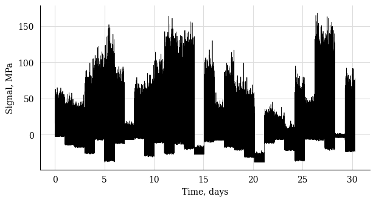
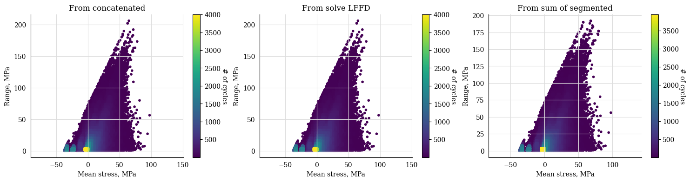
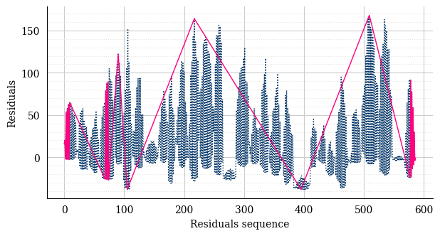

# 4. CycleCount sum { #5. }

[Jump to the worked notebook](#worked-notebook)

## a. List of signals (timeseries)

!!! note "Note"

    In this example we define a list of segmented timeseries and compare the sum of the `~py_fatigue.CycleCount` from segmented data with the `~py_fatigue.CycleCount` from concatenated data.

    We then apply the `~py_fatigue.CycleCount.solve_lffd` method, as per [LFFD](../additional/glossary.md) to recover the effect of low-frequency cycles.

Define the time and stress arrays

``` {.python linenos=""}
# input data
from collections import defaultdict
import py_fatigue.testing as test

signal_duration = int(86400 / 60)  # (in minutes)
max_peak = 200  # (in MPa)

# list of timestamps
timestamps = []

# list of timeseries
timeseries = []

# concatenated time and stress arrays
conc_time = np.empty(0)
conc_stress = np.empty(0)

# main loop
for i in range(0,30):
  np.random.seed(i)
  print(f"{i+1} / 30", end = "\r")
  min_ = - np.random.randint(3, 40)
  range_ = np.random.randint(1, 200)
  timestamps.append(
      datetime.datetime(2020, 1, i + 1, tzinfo=datetime.timezone.utc)
  )
  timeseries.append(defaultdict())

  time = test.get_sampled_time(duration=signal_duration, fs=10, start=i)
  stress = test.get_random_data(
    t=time, min_=min_, range_=range_, random_type="weibull", a=2., seed=i
  )
  conc_time = np.hstack(
    [conc_time, time + conc_time[-1] if len(conc_time) > 0 else time]
  )
  conc_stress = np.hstack([conc_stress, stress])
  timeseries[i]["data"] = stress
  timeseries[i]["time"] = time
  timeseries[i]["timestamp"] = timestamps[-1]
  timeseries[i]["name"] = "Example sum"

# Generating the timeseries dictionary
timeseries.append({"data": conc_stress, "time": conc_time,
                   "timestamp": timestamps[0], "name": "Concatenated"})

# concatenated timeseries plot
plt.plot(conc_time/60/24, conc_stress, 'k', lw=0.5)
plt.xlabel("Time, s")
plt.ylabel("Signal, MPa")
plt.show()
```

{ .docs-plot }

Define the CycleCount instances

``` {.python linenos=""}
cc = []
for t_s in timeseries:
    cc.append(pf.CycleCount.from_timeseries(**t_s))

# sum of the CycleCount instances
cc_sum = cc[0] + cc[1]

# CyclCeCount from concatenated data
cc_conc = pf.CycleCount.from_timeseries(**timeseries[-1])
```

|                                 | Concatenated |
|---------------------------------|--------------|
| Cycle counting object           |              |
| largest full stress range, MPa, | 189.71765    |
| largest stress range, MPa       | 206.0        |
| number of full cycles           | 143860       |
| number of residuals             | 31           |
| number of small cycles          | 0            |
| stress concentration factor     | N/A          |
| residuals resolved              | False        |
| mean stress-corrected           | No           |

: CycleCount from concatenated timeeries

``` {.python linenos=""}
# sum of the CycleCount instances
cc_sum.solve_lffd()
```

|                                 | Example sum |
|---------------------------------|-------------|
| Cycle counting object           |             |
| largest full stress range, MPa, | 189.71765   |
| largest stress range, MPa       | 206         |
| number of full cycles           | 143860      |
| number of residuals             | 31          |
| number of small cycles          | 0           |
| stress concentration factor     | N/A         |
| residuals resolved              | True        |
| mean stress-corrected           | No          |

: CycleCount from summed segmented timeeries after LFFD recovery

``` {.python linenos=""}
fig, axs = plt.subplots(1, 3, figsize=(16, 4))
cc_conc.plot_histogram(fig=fig, ax=axs[0], plot_type="mean-range")
cc_sum.solve_lffd().plot_histogram(fig=fig, ax=axs[1], plot_type="mean-range")
cc_sum.plot_histogram(fig=fig, ax=axs[2], plot_type="mean-range")

plt.show()
```

{ .docs-plot }

``` {.python linenos=""}
cc_sum.plot_half_cycles_sequence(lw=1)
plt.show()
```

{ .docs-plot }

## Worked notebook

[Open notebook](../../11-cycle_count_aggregation.html) ·
[Edit the notebook locally](01-notebook_setup.md)

<iframe class="docs-notebook" src="../../11-cycle_count_aggregation.html" title="Cycle count aggregation" loading="lazy"></iframe>
