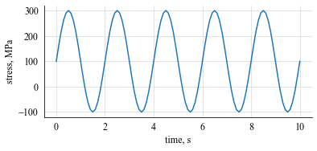
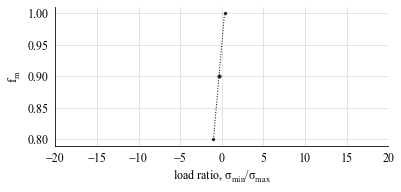
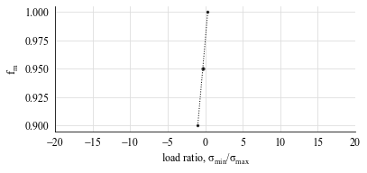
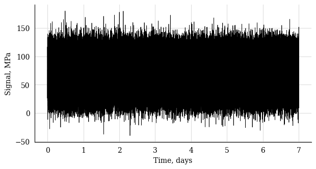
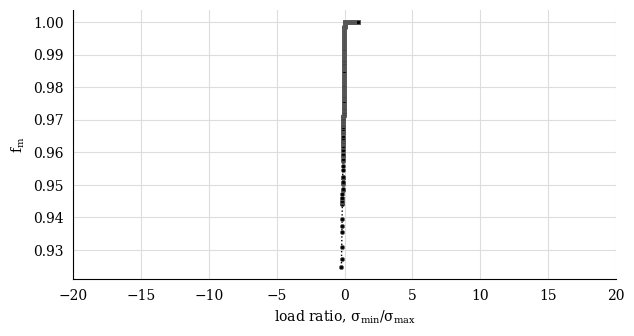
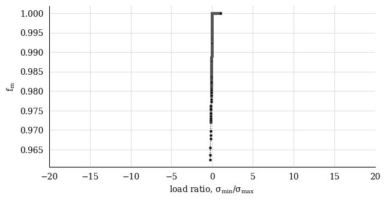
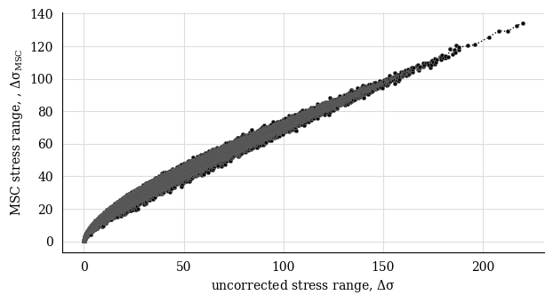

# 5. Mean stress effect { #6. }

[Jump to the worked notebook](#worked-notebook)

Fatigue is cyclic loading fracture. Cyclic loading contain load variation from minimum to maximum and this cycle repeats fornumber of times. When minimum and maximum load is same in magnitude but opposite in direction like tension and compressionor heating and cooling, then mean stress is zero. But when min and maxi load are not identical in magnitude then it contain someamount of residual stress which is called as mean stress. Mean stress affect the fatigue life of component. Generally positive ormean stress in tension has bad effect on component. Its life get reduced as mean stress get increased. But if mean stress is incompression then it increases the life of component

Structural members subjected to in-service cyclic loads exhibit a fatigue behavior that generally depends on the mean stress values. Mean stress is generally taken as average of minimum stress and maximum stress. Mean stress in cyclic loading plays important role. For a given fatigue load range a tensile mean normal stress has a detrimental effect on fatigue strength, whereas, in general, a compressive mean normal stress has a beneficial effect. The problem of the mean stress effect on fatigue life has been approached practically by developing empirical relationships. For metals and alloys, various criteria have been proposed to deal with the mean stress effect on fatigue life.

In [py-fatigue]{.title-ref} the mean stress effect can be compensated by using any of the following models:

- DNVGL-RP-C203;
- Walker;
- Smith-Watson-Topper.

## DNVGL-RP-C203 correction

Calculates the mean stress correction according to par. 2.5 of DNVGL-RP-C203, which includes an attenuation factor $p$ for the stress ranges if the following cases:

- base material without significant residual stresses $\rightarrow p = 0.6$. This option neglects fully compressive cycles.
- welded connections without significant residual stresses $\rightarrow p = 0.8$. This option multiplies the stress range of fully compressive cycles by p.

Given that the stress ranges are $\Delta \sigma$, the corrected stress ranges are:

$$\Delta \sigma_{corr} = f_m \cdot \Delta \sigma$$

where:

$$f_m = \frac{\sigma_{max} + p \cdot \vert \sigma_{min}
\vert}{\sigma_{max} + \vert\sigma_{min} \vert}$$

with:

$$\frac{\sigma_a}{\vert \sigma_m \vert} \leq 1, \quad
\sigma_a = \frac{\sigma_{max} - \sigma_{min}}{2} \,\land
\, \sigma_m = \frac{\sigma_{max} + \sigma_{min}}{2}$$

## Walker correction

Calculates the mean stress correction according to Walker model.

The correction is given by:

$$\Delta \sigma_{corr} = {\sigma_{max}} ^ {(1 - \gamma)} \,
\sigma_{alt} ^ {\gamma}$$

with:

$$\sigma_{max} = \sigma_{mean} + \sigma_{alt}$$

## Smith-Watson-Topper

Calculates the mean stress correction according to Smith-Watson-Topper model. It is equivalent to the Walker model with gamma = 0.5.

The correction is given by:

$$\Delta \sigma_{corr} = \sqrt{\sigma_{max} \, \sigma_{alt}}$$

with:

$$\sigma_{max} = \sigma_{mean} + \sigma_{alt}$$

## a. Constant signal

!!! note "Note"

    In this example we define a fatigue stress signal in the form of a sinusoidal function and calculate the damage using the [Palmgren-Miner Rule](../additional/glossary.md).

    We then feed our signal to the `~CycleCount` class.

Define the time and stress arrays

``` python
t = np.arange(0, 10.1, 0.1)  # (in seconds)
s = 200 * np.sin(np.pi*t) + 100   # (in MPa)
plt.plot(t, s)
plt.xlabel("time, s")
plt.ylabel("stress, MPa")
plt.show()
```

{ .docs-plot }

Define the CycleCount instance

``` python
cc = pf.CycleCount.from_timeseries(s, t, name="Example")
cc
```

|                                 | Example |
|---------------------------------|---------|
| Cycle counting object           |         |
| largest full stress range, MPa, | None    |
| largest stress range, MPa       | 400.0   |
| number of full cycles           | 0       |
| number of residuals             | 11      |
| number of small cycles          | 0       |
| stress concentration factor     | N/A     |
| residuals resolved              | False   |
| mean stress-corrected           | No      |

: CycleCount from constant time series

Apply the DNVGL-RP-C203 mean stress effect correction

``` python
cc_corr_6 = cc.mean_stress_correction(
  correction_type = "DNVGL-RP-C203",
  plot = True,
  detail_factor=0.6,
)
cc_corr_8 = cc.mean_stress_correction(
  correction_type = "DNVGL-RP-C203",
  plot = True,
  detail_factor=0.8,
)
cc_corr_6
```

{ .docs-plot }

{ .docs-plot }

|                                 | Example                                 |
|------------------------------------|------------------------------------|
| Cycle counting object           |                                         |
| largest full stress range, MPa, | None                                    |
| largest stress range, MPa       | 360                                     |
| number of full cycles           | 0                                       |
| number of residuals             | 11                                      |
| number of small cycles          | 0                                       |
| stress concentration factor     | N/A                                     |
| residuals resolved              | True                                    |
| mean stress-corrected           | DNVGL-RP-C203: {'detail_factor': 0.6} |

: CycleCount from constant time series

## b. Normally-distributed signal

!!! note "Note"

    In this example we define a fatigue stress signal in the form of a sinusoidal function and calculate the damage using the [Palmgren-Miner Rule](../additional/glossary.md).

    We then feed our signal to the `~CycleCount` class.

Define the time and stress arrays

``` python
import py_fatigue.testing as test

time = test.get_sampled_time(duration=604800, fs=1)  # 1 week
stress = test.get_random_data(
  t=time, min_=-40, range_=220, random_type="normal", scale=1., seed=42
)
# Generating the timeseries dictionary
timeseries = {
  "data": stress,
  "time": time,
  "timestamp": datetime.datetime(2020, 1, 1, tzinfo=datetime.timezone.utc),
  "name": "One week time series",
  "range_bin_width":  5.0,
  "mean_bin_width":  5.0,
}

# concatenated timeseries plot
plt.plot(time / 86400, stress, 'k', lw=0.5)
plt.xlabel("Time, days")
plt.ylabel("Signal, MPa")
plt.show()
```

{ .docs-plot }

Define the CycleCount instance

``` python
cc = pf.CycleCount.from_timeseries(**timeseries)
cc
```

|                                 | One week time series |
|---------------------------------|----------------------|
| Cycle counting object           |                      |
| largest full stress range, MPa, | 217.197668           |
| largest stress range, MPa       | 220.0                |
| number of full cycles           | 201509               |
| number of residuals             | 21                   |
| number of small cycles          | 0                    |
| stress concentration factor     | N/A                  |
| residuals resolved              | False                |
| mean stress-corrected           | No                   |

: CycleCount from normally-distributed time series

### DNVGL-RP-C203 mean stress effect correction

Apply the DNVGL-RP-C203 mean stress effect correction

``` python
cc_corr_6 = cc.mean_stress_corrections(
  correction_type = "DNVGL-RP-C203",
  plot = True,
  detail_factor=0.6,
)
cc_corr_8 = cc.mean_stress_correction(
  correction_type = "DNVGL-RP-C203",
  plot = True,
  detail_factor=0.8,
)
cc_corr_6
```

!!! warning "Warning"

    If mean stress correction is performed in the contest of long-term fatigue analysis, please perform the sum of multiple CycleCount instances prior mean stress correction (MSC).

    In fact, applying the MSC before summing into long-term CycleCount instance results in non-conservative life estimates, as after MSC, low-frequency fatigue cannot be estimated accurately.

|                                 | One week time series                    |
|------------------------------------|------------------------------------|
| Cycle counting object           |                                         |
| largest full stress range, MPa, | 202.194963                              |
| largest stress range, MPa       | 204.0                                   |
| number of full cycles           | 201509                                  |
| number of residuals             | 21                                      |
| number of small cycles          | 0                                       |
| stress concentration factor     | N/A                                     |
| residuals resolved              | True                                    |
| mean stress-corrected           | DNVGL-RP-C203: {'detail_factor': 0.6} |

: DNVGL Mean stress-corrected CycleCount from normally-distributed time series

{ .docs-plot }

{ .docs-plot }

### Walker mean stress effect correction

Apply the Walker mean stress effect correction

``` python
cc_corr_walk = cc.mean_stress_correction(
  correction_type = "walker",
  plot = True,
  gamma=0.6,
)
cc_corr_walk
```

|                                 | One week time series     |
|---------------------------------|--------------------------|
| Cycle counting object           |                          |
| largest full stress range, MPa, | 132.832864               |
| largest stress range, MPa       | 133.950585               |
| number of full cycles           | 201509                   |
| number of residuals             | 21                       |
| number of small cycles          | 0                        |
| stress concentration factor     | N/A                      |
| residuals resolved              | True                     |
| mean stress-corrected           | WALKER: {'gamma': 0.6} |

: Walker Mean stress-corrected CycleCount from normally-distributed time series

{ .docs-plot }

## Worked notebook

[Open notebook](../../21-mean_stress_and_equivalent_loads.html) ·
[Edit the notebook locally](01-notebook_setup.md)

<iframe class="docs-notebook" src="../../21-mean_stress_and_equivalent_loads.html" title="Mean stress and equivalent loads" loading="lazy"></iframe>
