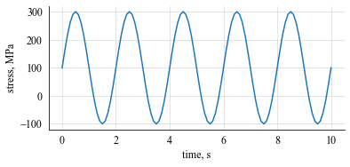

# 7. Stress-Life damage calculation {#7. Stress-Life damage calculation}

This section contains some examples of damage calculations using the stress-life approach.

The module `py_fatigue.damage.stress_life` contains all the damage models related to the stress-life approach.

The simplest and most common damage model is the Palmgren-Miner (`py_fatigue.damage.stress_life.calc_pm`, `py_fatigue.damage.stress_life.get_pm`) model.

$$D = \sum_{j=1}^{N_{\text{blocks}}} \frac{n_j}{N_j} \leq 1$$

Besides the linear damage accumulation rule, [py-fatigue]{.title-ref} also provides a series of nonlinear damage accumulation models callable through `py_fatigue.damage.stress_life.calc_nonlinear_damage` and `py_fatigue.damage.stress_life.get_nonlinear_damage`

- Manson and Halford
- Si Jian *et al.*
- Pavlou
- Leve

The generic form of a nonlinear damage rule is:

$$D = \left(
    \left( \dots
        \left(
            \left(
                \left(\frac{n_1}{N_1}\right)^{e_{1, 2}} +
                \frac{n_2}{N_2}
            \right)^{e_{2, 3}} +
            \frac{n_3}{N_3}
        \right)^{e_{3, 4}} + \dots + \frac{n_{M-1}}{N_{M-1}}
    \right)^{e_{M-1, M}} + \dots + \frac{n_M}{N_M}
\right)^{e_M}$$

where $n_j$ is the number of cycles in the fatigue histogram at the $j$-th cycle, $N_j$ is the number of cycles to failure at the $j$-th cycle, $e_{j, j+1}$ is the exponent for the $j$-th and $j+1$-th cycles, $M$ is the number of load blocks in the fatigue spectrum.

The formula is conveniently rewritten as pseudocode:

``` {.python caption="pseudocode for the nonlinear damage rule"}
# retrieve N_j using the fatigue histogram and SN curve
# retrieve the exponents e_{j, j+1}
#  calculate the damage
D = 0
for j in range(1, M+1):
    D = (D + n_j / N_j) ^ e_{j, j+1}
```

Specifically, for the damage models currently implemented in [py_fatigue]{.title-ref}, the exponents are:

- Manson and Halford: $e_{j, j+1} = \left(\frac{N_{j}}{N_{j+1}}\right)^{\alpha}$ with $\alpha=0.4$ usually.
- Si Jian *et al.*: $e_{j, j+1} = \sigma_{j+1} / \sigma_{j}$ where $\sigma_{j+1}$ is the stress amplitude for the $j$-th cycle.
- Pavlou: $e_{j, j+1} = \left(\frac{\Delta \sigma_j / 2}{\sigma_U}\right)^{\alpha}$ where $\Delta \sigma_j/2$ is the stress amplitude, $\sigma_U$ is the ultimate stress, $\Delta \sigma$ is the stress range and $\alpha=0.75$ (usually) is the exponent.
- Leve: $e_{j, j+1} =\text{constant}$.

## 1. Palmgren-Miner

### a. Constant fatigue load (sinoid)

!!! note "Note"

    In this example we define a fatigue stress signal in the form of a sinusoidal function and calculate the damage using the [Palmgren-Miner Rule](../additional/glossary.md).

    We then feed our signal to the `~CycleCount` class.

Define the time and stress arrays

``` python
t = np.arange(0, 10.1, 0.1)  # (in seconds)
s = 200 * np.sin(np.pi*t) + 100   # (in MPa)
plt.plot(t, s)
plt.xlabel("time, s")
plt.ylabel("stress, MPa")
plt.show()
```



Define the CycleCount instance

``` python
cc = pf.CycleCount.from_timeseries(s, t, name="Example")
cc
```

|                                 | Example |
|---------------------------------|---------|
| Cycle counting object           |         |
| largest full stress range, MPa, | None    |
| largest stress range, MPa       | 400.0   |
| number of full cycles           | 0       |
| number of residuals             | 11      |
| number of small cycles          | 0       |
| stress concentration factor     | N/A     |
| residuals resolved              | False   |
| mean stress-corrected           | No      |

: CycleCount from constant time series

Define the SN curve

``` {.python linenos=""}
w3a = pf.SNCurve([3, 5], [10.970, 13.617],
                 norm='DNVGL-RP-C203', curve='W3', environment='Air')
```

There are two main ways of calculating the damage from [cc]{.title-ref}.

1.  Using the `~pf.stress_life.get_pm` method.
2.  Converting [cc]{.title-ref} to a `~pandas.DataFrame` and using the dataframe extension called `df.miner.damage`.

``` {.python linenos=""}
df = cc.to_df()
df.miner.damage(w3a)
print(df)
print(f"Damage from pandas df: {df['pm_damage'].sum()}")
print(f"Damage from  function: {pf.damage.stress_life.get_pm(cc, w3a)}")
```

Which outputs:

| index | count_cycle | mean_stress | stress_range | cycles_to_failure | pm_damage |
|-------|-------------|-------------|--------------|-------------------|-----------|
| 0     | 0.5         | 200         | 200          | 11665.68          | 0.000043  |
| 1     | 0.5         | 100         | 400          | 1458.21           | 0.000343  |
| 2     | 0.5         | 100         | 400          | 1458.21           | 0.000343  |
| 3     | 0.5         | 100         | 400          | 1458.21           | 0.000343  |
| 4     | 0.5         | 100         | 400          | 1458.21           | 0.000343  |
| 5     | 0.5         | 100         | 400          | 1458.21           | 0.000343  |
| 6     | 0.5         | 100         | 400          | 1458.21           | 0.000343  |
| 7     | 0.5         | 100         | 400          | 1458.21           | 0.000343  |
| 8     | 0.5         | 100         | 400          | 1458.21           | 0.000343  |
| 9     | 0.5         | 100         | 400          | 1458.21           | 0.000343  |
| 10    | 0.5         | 0           | 200          | 11665.68          | 0.000043  |

```
Damage from pandas df: 0.0031716971435032985
Damage from  function: 0.0031716971435032985
```
